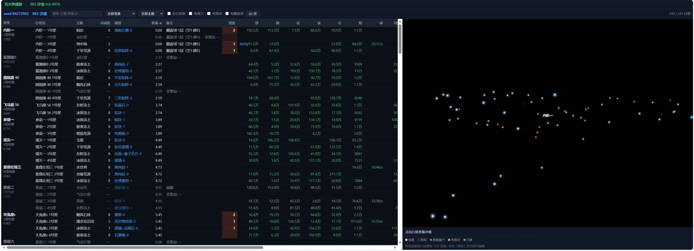
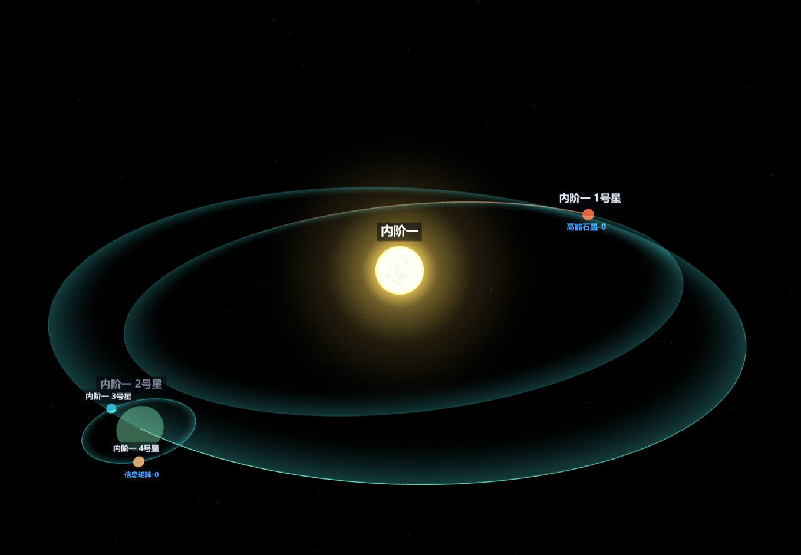
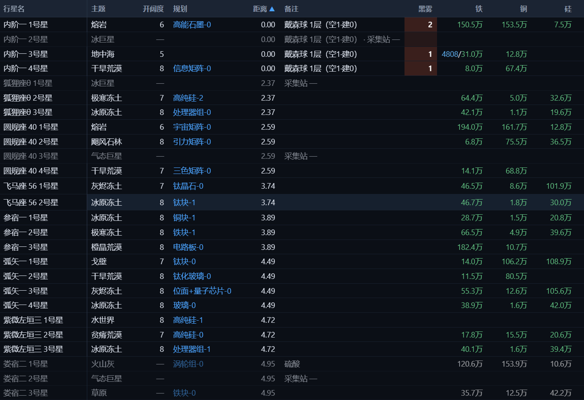
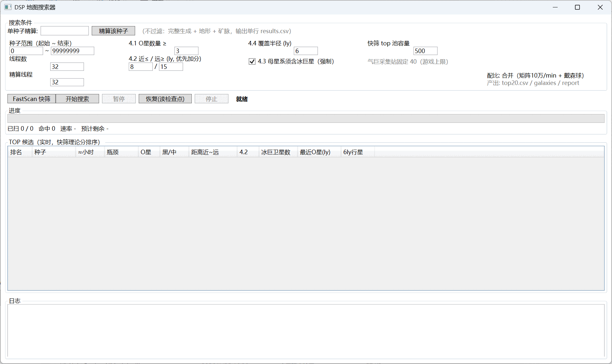
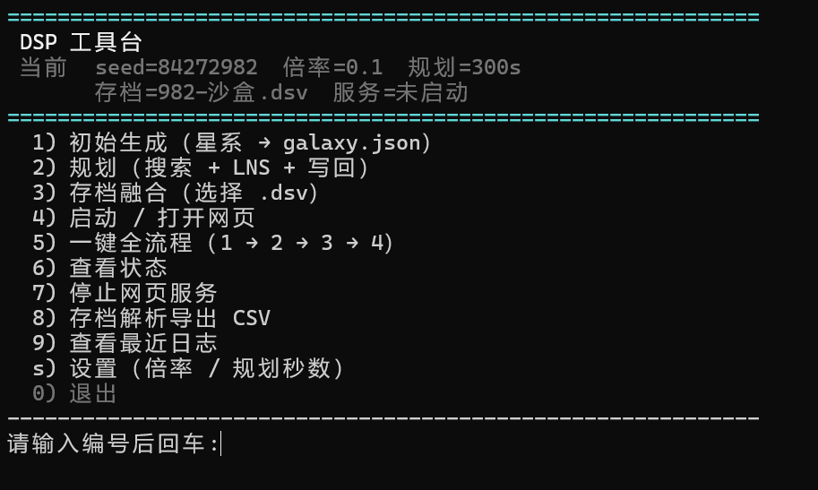

# DSP 星系浏览器 / 规划器

戴森球计划（Dyson Sphere Program）的单种子工具链：**种子 → 星系/行星/矿脉 → 生产规划 → 存档融合 → 网页浏览（表格 + 3D）**。

> 本仓库只包含自研工具代码与文档。**不包含**游戏本体、游戏程序集、反编译源码或游戏原始资源包。

## 功能

**核心用途：一眼看出下一步去哪个星球开采**

游戏里查资源得一颗颗行星点进去看。这里把整个星系摊平成一张表：每颗行星的剩余 / 已规划 / 未规划矿量、
气巨采集站占用、黑雾威胁、戴森球与规划状态全在眼前，打开就知道该去哪开采、哪颗星不用去了。

- **资源一览**：14 种矿物按「剩余 / 已规划（蓝，有采矿机）/ 未规划（绿，待规划）」展示，模型推算值标白，采空预警标红
- **气 / 冰巨星采集站**：备注列直接显示 `采集站 6/40` —— 建满没有一眼可见，省得空跑一趟
- **火种预警**：黑雾火种（tinder）追踪 + 预计抵达时间（ETA）提示条，提前知道哪颗星要遭
- **黑雾态势**：地面基地数（本地 + relay 双口径）、太空巢穴数（1~6 色阶）、戴森球层状态
- **种子生成链复刻**：从 `galaxySeed` 复现恒星/行星/主题/地形/矿脉，与存档逐颗对拍一致
- **全空间搜索**：x86 精算（与游戏浮点一致）+ net8 快筛
- **生产规划**：按目标配比（宇宙矩阵 / 戴森球）做基地选址与运输成本优化（退火 + LNS）
- **存档解析 / 融合**：中文名、剩余储量、已探索、工厂、戴森球、黑雾、采集站
- **网页浏览器**：27 列平铺行星表 + 3D 星系/恒星系双视图 + 规划文本编辑

### 性能（i9-13980HX 实测）

- **快筛**：32 线程约 **1 万 seeds/s**（实测 10,258/s），全空间 0~99,999,999 约 **2.7 小时**；
  net8 自包含引擎（DspFastScan）再快约 **5.5 倍**（1,800 → 10,000 seeds/s）
- **精算**：全量地形 + 矿脉约 **27 秒/种子**，top 500 × 16 核约 **14 分钟**
- **存档解析**：888 MB 档约 **1.7 秒**；931 MB 档融合（merge）约 **8.4 秒**

## 界面预览

**浏览器：行星表 + 3D 星系视图**（左侧 27 列平铺表，右侧星系全景）



双击恒星进入**恒星系视图**（轨道 / 行星 / 规划标签），ESC 返回：



**规划与矿量列**：已规划（蓝）/ 未规划（绿）/ 模型推算（白）/ 采空预警（红）；黑雾列按太空巢穴数着色：



**搜索器（WPF）**：全空间扫描 0~1e8，快筛 + 精算两阶段



**双击菜单（DSP.bat）**：生成 / 规划 / 融合 / 渲染一条龙



## 前置要求

- Windows 10/11
- .NET SDK 8.0
- Visual Studio 2022（或 MSBuild，用于构建 net48 工程）
- 已安装的戴森球计划（提供 `Assembly-CSharp.dll` 等托管程序集）

## 配置游戏目录

构建时需要引用游戏托管程序集，任选一种：

```powershell
# 方式一：环境变量（推荐）
$env:DSP_GAME_DIR = "<Steam 库>\steamapps\common\Dyson Sphere Program"

# 方式二：构建参数
MSBuild src\DspSearcher.sln /p:DspGameDir="<游戏安装目录>"
```

默认值已移除（仓库不含本机路径）；未设置时会直接报错并提示具体路径。

## 构建

```powershell
# net48 工程（DspCore48 / DspSearcher / DspSave）+ net8 工程（DspView / DspFastScan）
MSBuild src\DspSearcher.sln /p:Configuration=Debug

# 规划器用 Release 构建
dotnet build src\DspPlan\DspPlan.csproj -c Release
```

## 使用

```powershell
# 双击菜单（推荐）
src\scripts\DSP.bat

# 或子命令
src\scripts\dsp.ps1 init  84272982 -Mult 0.1
src\scripts\dsp.ps1 plan  84272982 -Seconds 300
src\scripts\dsp.ps1 merge 84272982 -Save "my-save.dsv"
src\scripts\dsp.ps1 serve 84272982
```

完整命令与端到端流程见 [`src/docs/COMMANDS.md`](src/docs/COMMANDS.md)。

## 仓库结构

```
src\                  公开代码
├── DspCore48\        生成引擎 + 存档解析（net48/net8 双目标）
├── DspSearcher\      搜索器 / 单种子精算（net48 x86，必须 x86 对齐游戏浮点）
├── DspSave\          存档解析 / 融合（net8 x64，大档专用）
├── DspFastScan\      快筛引擎（net8 x64）
├── DspPlan\          规划器（net8，退火 + LNS）
├── DspView\          网页渲染 + 本地服务（net8）
├── data\             原型数据（物品/配方/科技/主题/矿脉 + 配比分析）
├── docs\             文档（README / COMMANDS / 方案与实现）
├── scripts\          双击菜单与命令行封装（DSP.bat / dsp.ps1）
└── tools\            数据生成与校验脚本

ref\                  本地参考资料（不随仓库发布，见 .gitignore）
```

## 数据来源与声明

- `src\data\` 的数值由本机安装的游戏资源解码得到，仅用于研究与个人使用。
- 游戏内容版权归 **Youthcat Studio / Gamera Game** 所有。
- 本仓库不包含游戏本体、游戏程序集、反编译源码或原始资源包。

## 许可证

GPL-3.0。行星生成算法部分基于 [DspFindSeed](https://github.com/baicai-1145/DspFindSeed)（GPL-3.0），详见 `LICENSE`。
